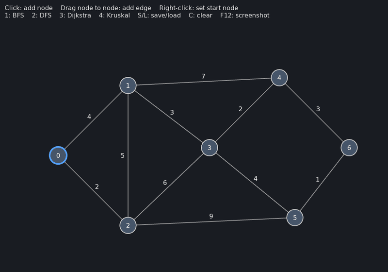
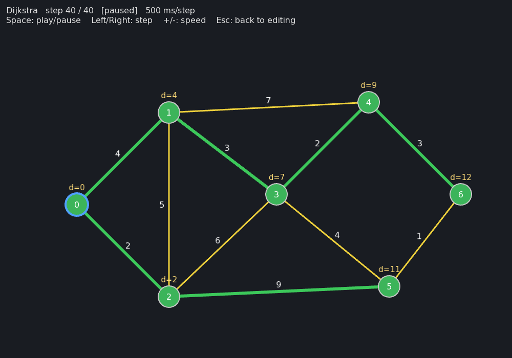
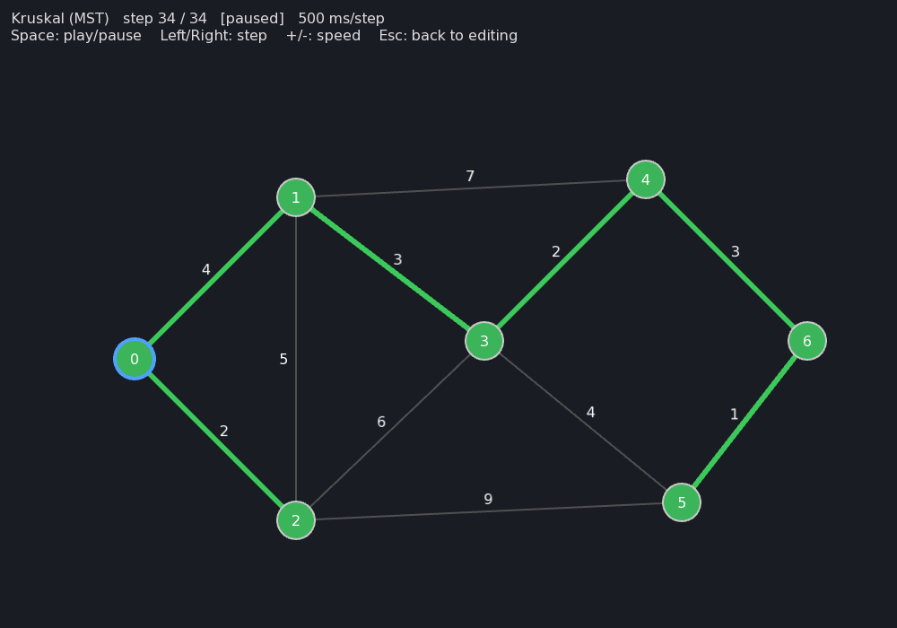

# Graph Algorithms Visualizer

Build a weighted graph with the mouse and watch **BFS, DFS, Dijkstra and Kruskal** run on it step by step, forward and backward. Written in C++17 with SFML. The algorithm engine has no GUI code in it and is covered by unit tests.



## Features

- **Interactive editing:** click to add nodes, drag between nodes to add an edge, then type its weight.
- **Four algorithms:** BFS, DFS, Dijkstra (shortest paths) and Kruskal (minimum spanning tree).
- **Step-by-step playback:** play/pause, step forward *and* backward, and change the speed.
- **Live distances:** Dijkstra shows each node's current best distance (`d=…`) as it improves.
- **Save/load** graphs as a simple text file. A demo graph loads at startup.
- **Engine independent of the GUI:** algorithms return a list of step events and never touch SFML.

| Dijkstra: shortest-path tree from node 0 | Kruskal: minimum spanning tree (total weight 15) |
|---|---|
|  |  |

## Controls

| Editing | |
|---|---|
| Left click on empty space | Add a node |
| Drag from a node to another node | Add an edge, then type its weight and press **Enter** (**Esc** cancels) |
| Right click on a node | Set the start node (blue outline) |
| **1** / **2** / **3** / **4** | Run BFS / DFS / Dijkstra / Kruskal |
| **S** / **L** | Save to / load from `graph.txt` |
| **C** | Clear the graph |
| **F12** | Save a screenshot |

| During an animation | |
|---|---|
| **Space** | Play / pause (restarts when at the end) |
| **←** / **→** | Step backward / forward |
| **+** / **−** | Faster / slower |
| **Esc** | Back to editing |

**Colors:** orange = discovered, green = finished or part of the result, yellow = edge examined, dark grey = edge rejected (it would create a cycle).

## Build and run (Windows, MSYS2)

1. Install [MSYS2](https://www.msys2.org/). In the **MSYS2 UCRT64** shell, run:
   ```bash
   pacman -S mingw-w64-ucrt-x86_64-gcc mingw-w64-ucrt-x86_64-sfml
   ```
2. Add `C:\msys64\ucrt64\bin` to your `PATH`. Put it *before* other programs that ship their own `libstdc++-6.dll`. Otherwise the exe can fail with "entry point not found".
3. **VS Code:** open the folder (with the C/C++ extension installed):
   - **Ctrl+Shift+B** builds the app.
   - **F5** builds and runs it.
   - Tests: run the task **Build Catch2 (run once)**, then **Tasks: Run Test Task**.

**Or from the MSYS2 UCRT64 shell**, in the project folder:
```bash
g++ -std=c++17 -Wall -Wextra -Isrc src/core/*.cpp src/app/*.cpp src/main.cpp \
    -o build/graphviz.exe -lsfml-graphics -lsfml-window -lsfml-system
./build/graphviz.exe        # run from the project folder (it loads assets/ and examples/)
```

Run the tests:
```bash
g++ -std=c++17 -c tests/catch2/catch_amalgamated.cpp -o build/catch2.o     # once (slow)
g++ -std=c++17 -Wall -Wextra -Isrc -Itests/catch2 src/core/*.cpp tests/test_*.cpp \
    build/catch2.o -o build/tests.exe
./build/tests.exe
```

## How it works

```
 src/core   (pure C++17, no SFML)
 ┌──────────────────────────────────────────────────────────────────────┐
 │  Graph ──► algo::bfs / dfs / dijkstra / kruskal ──► vector<Step>     │
 │                                                          │           │
 │                               replay(steps, k) ──► VisualState       │
 └──────────────────────────────────────────────────────────┼───────────┘
 src/app    (SFML)                                          ▼
 ┌──────────────────────────────────────────────────────────────────────┐
 │  InputHandler (edits the Graph)   Renderer (draws Graph+VisualState) │
 │  App (window, main loop, keyboard shortcuts, Animator)               │
 └──────────────────────────────────────────────────────────────────────┘
```

- An algorithm runs to completion instantly and returns a list of **step events** such as `VisitNode 3`, `ConsiderEdge 5`, `AcceptEdge 5` or `SetDistance 4 = 9`.
- `replay(steps, k)` rebuilds what the screen should show after the first `k` steps. Stepping **backward** is just `k - 1`, so there's no undo logic at all.
- The `Animator` only stores `k` and a timer. The `Renderer` turns the state into colors.
- Editing is locked while an animation is shown, because steps refer to edges by index.
- The test build compiles `src/core` with no SFML flags, so the engine can't come to depend on the GUI without breaking that build.

## Algorithms

| Algorithm | Time | Extra space | What the animation shows |
|---|---|---|---|
| BFS | O(V + E) | O(V) | Nodes discovered level by level, and the BFS tree |
| DFS (recursive) | O(V + E) | O(V) | How far it goes before backtracking, and the DFS tree |
| Dijkstra (binary heap) | O((V + E) log V) | O(V + E) | Distances improving, and the final shortest-path tree |
| Kruskal (union-find) | O(E log E) | O(V + E) | Edges taken by weight: accepted, or rejected if they'd make a cycle |

Recording the steps adds O(V + E) memory, since each node and edge produces a constant number of events. Weights are integers ≥ 1, and edges are undirected.

## Testing

23 test cases (81 assertions) with [Catch2](https://github.com/catchorg/Catch2), on small graphs where the answer can be worked out by hand:

- **Graph:** sequential ids; rejects self-loops, duplicates, bad ids and weights below 1; edges are undirected.
- **BFS/DFS:** exact visit order, unreachable nodes, start on an isolated node, invalid start.
- **Dijkstra:** a cheaper path with more hops beats a direct edge; unreachable stays at -1; exactly the shortest-path tree is accepted.
- **Kruskal:** V − 1 edges with the minimum total weight; cycle edges are rejected; a disconnected graph gives a forest.
- **Animator:** replay bounds, step back/forward, speed limits, restart at the end.
- **Save/load:** round trip, comments and blank lines, malformed files rejected.

The GUI is tested by hand.

## Graph file format

```
# comments and blank lines are ignored
n 150 400      # node: x y   (ids follow line order, starting at 0)
n 330 220
e 0 1 4        # edge: u v weight
```

See [`examples/sample.txt`](examples/sample.txt).

## Project structure

```
src/core/   Graph, Step, Algorithms, Animator (replay), GraphIO   (no SFML)
src/app/    App (main loop), InputHandler, Renderer               (SFML)
tests/      Catch2 unit tests for everything in src/core
examples/   sample graph loaded at startup
assets/     font
.vscode/    build / run / test tasks
```

## Possible extensions

- CMake build for Linux/macOS
- Directed graphs, Prim and A*
- Deleting nodes and edges, zoom and pan

## Third-party

- [SFML 2.6](https://www.sfml-dev.org/) (zlib license)
- [Catch2 v3.7.1](https://github.com/catchorg/Catch2) (BSL-1.0), bundled in `tests/catch2/`
- [DejaVu Sans](https://dejavu-fonts.github.io/) font, license in `assets/DejaVu-LICENSE.txt`
